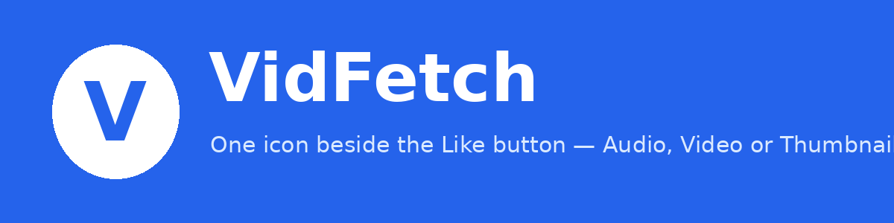
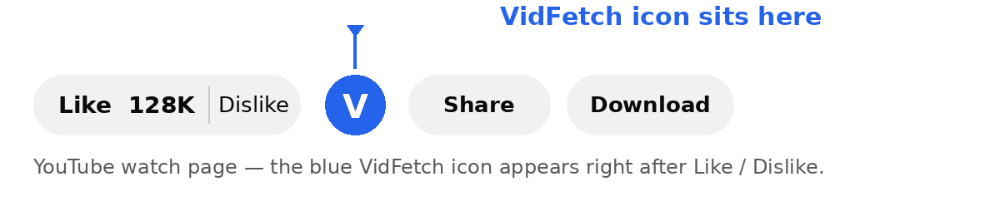
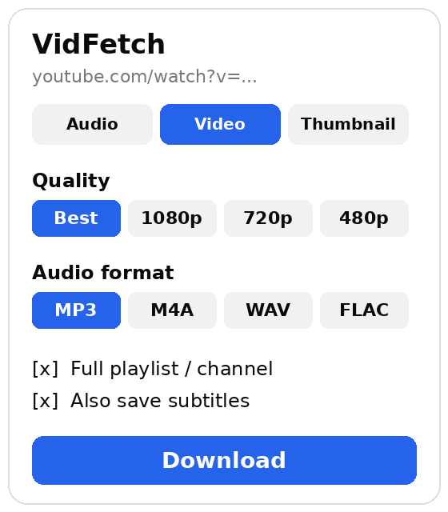

# VidFetch — v1.4.4



**One blue icon beside the YouTube Like button. Click it, pick Audio, Video or Thumbnail, and the file downloads to your folder.**

VidFetch works on YouTube, Facebook, TikTok, Instagram, X and 1800+ other sites. No account, no ads, no cloud, nothing uploaded — everything runs on your own computer.

## WhatsApp Channel

Updates, new versions and help:

**https://whatsapp.com/channel/0029VbDjJOH5kg75djXvbR0R**





## What's new in 1.4.4

- **The helper starts by itself.** Run `setup.bat` once and the helper runs hidden with Windows login. If it ever stops, clicking the VidFetch icon starts it again automatically (native messaging host).
- **yt-dlp updates itself** — on startup, every 12 hours, and whenever YouTube changes break downloads.
- **Thumbnails only from the Thumbnail button.** Audio/Video downloads never save or embed a thumbnail.
- **The icon sits only beside the Like button** on YouTube watch pages — nowhere else, no floating button.
- **Fixed extension ID**, so reinstalling keeps the same ID.

## Features

- **Audio / Video / Thumbnail** — three separate downloads. Thumbnail downloads only the cover image (.jpg).
- **All qualities** — Video 144p–4K, Audio 96–320 kbps, formats MP3 / M4A / WAV / FLAC.
- **Playlist / channel download** — tick "Full playlist / channel" to download every video into its own folder.
- **Subtitles** — English + Bangla .srt when available.
- **Download history + Open folder** in the popup.
- **Toolbar popup** — paste any link for sites without a button.

## Install (Windows 10/11 + Chrome or Edge)

1. **Download** the latest release ZIP from [Releases](https://github.com/naimxislambd/vidfetch-extension/releases) and extract it.
2. **Run `setup.bat` once.** It installs Python + ffmpeg + yt-dlp and sets the helper to start with Windows.
3. **Pick a save folder** — a tab opens at `http://127.0.0.1:8766/setup` (default: `Music/VidFetch`).
4. **Load the extension** — open `chrome://extensions`, turn on **Developer mode**, click **Load unpacked**, select the `extension` folder.
5. Open any YouTube video — the blue VidFetch icon appears beside the Like button.

## Usage

**On YouTube** — click the blue icon beside Like. Pick **Video**, **Audio** or **Thumbnail**, then the quality (Thumbnail needs no quality). Tick Playlist / Subtitles if you want them, then **Download**.

**Anywhere else** — click the VidFetch icon in the toolbar, paste a link, pick Audio/Video + quality, hit **Grab**. The popup shows live progress and your recent downloads.

**Playlist warning:** a big playlist is many files — it takes a while and uses a lot of disk. Try a small playlist first.

## How it works

```
YouTube / FB / TikTok page ──► extension ──► 127.0.0.1:8766 ──► yt-dlp + ffmpeg ──► your folder
```

- **`extension/`** — Manifest V3. Injects the icon beside Like, sends the video URL to the helper, polls for progress.
- **`helper.py`** — a local server on `127.0.0.1:8766`. Runs yt-dlp, detects finished files, keeps download history.
- **`native_host.py`** — starts the helper automatically when the extension asks.
- **`setup.ps1` / `start-helper.bat` / `stop-helper.bat` / `uninstall.bat`** — install, run, stop, remove.

### Security

- The helper binds to **loopback only** — nothing on your network can reach it.
- `POST /download` accepts **only** `chrome-extension://` and `moz-extension://` origins — a random website cannot make your machine download anything.
- Only one helper can hold the port; a second instance refuses and says so.

## Troubleshooting

**"helper not running"** — run `setup.bat` once, then click the icon again. The icon starts the helper by itself. To see the console, run `start-helper-console.bat`.

**Icon doesn't appear** — reload the extension at `chrome://extensions` (the card should read **1.4.4**), then hard-refresh the tab (Ctrl+Shift+R).

**"This site is not supported"** — yt-dlp covers 1800+ sites but not all. DRM services (Netflix, Disney+, Spotify) and phone-app-only content are not supported. VidFetch never touches your accounts.

**A download fails** — press F12, open Console, look for lines starting with `[VidFetch]`. The helper log is in `helper.log`.

## Legal

This is a UI over `yt-dlp`. It does not bypass DRM, paywalls or access controls, and it runs entirely on your machine with no server component.

**You are responsible for what you download.** Downloading copyrighted material without permission may be illegal where you live, and it breaks the terms of service of most platforms. Use it for content you own, content licensed for reuse (Creative Commons, public domain), or content you have explicit permission to copy.

## Credit

VidFetch is built from [Gugu Grab](https://github.com/mustavirafid-dev/gugu-grab) by Mustavi Rafid (MIT licence) — rebranded to VidFetch with playlist, thumbnail/subtitle, history, WAV/FLAC/M4A, auto-start helper and Like-button icon added. Original MIT licence kept in `LICENSE`.

## Licence

MIT — see `LICENSE`.
